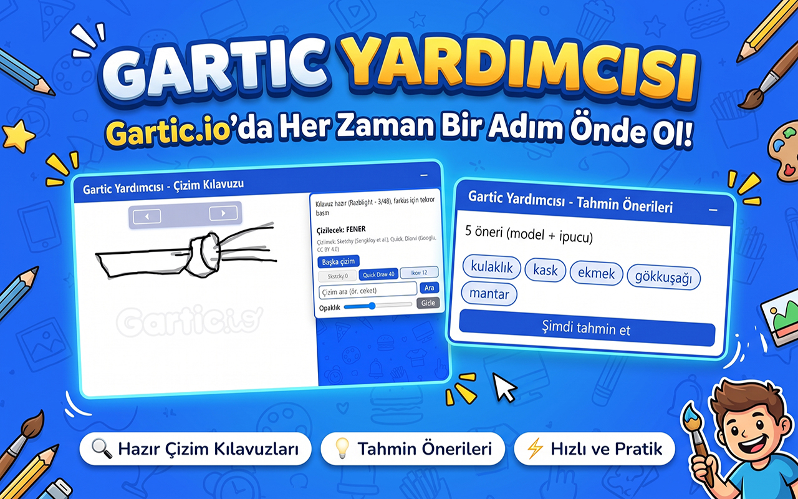

# Gartic Helper



- **Chrome Web Store'dan indir:** https://chromewebstore.google.com/detail/gartic-helper/oblnfkojabmbpgaoaefbpjpimhdlgafh
- **Tanıtım videosu:** https://www.youtube.com/watch?v=0XsiEH_jV8U

[Gartic.io](https://gartic.io) için Chrome eklentisi. Çizme sırası sendeyken kelimeye uygun bir çizim referansı gösterir; tahmin ederken de ekrandaki çizime ve ipucu kalıbına bakarak kelime önerir.

## Ne işe yarar?

- **Çizim kılavuzu:** Sıra sende olduğunda seçtiğin kelimenin örnek bir çizimini oyun alanının üstüne yarı saydam bir katman olarak koyar, sen de onun üstünden çizersin. Çizimler sırasıyla şu kaynaklardan gelir: Sketchy veri seti, Google Quick Draw ve yedek olarak Iconify ikonları. Beğenmezsen "Başka çizim" ile bir sonrakine geçersin.
- **Tahmin önerileri:** Başkası çizerken tuval belirli aralıklarla yakalanır ve tarayıcıda çalışan bir Quick Draw CNN modeline (ONNX Runtime Web) verilir. Model sonuçları; ipucu kalıbıyla (harf sayısı, açılan harfler) ve sohbette çıkan "çok yakın" tahminlerle birleştirilip Türkçe kelime listesi olarak bir panelde gösterilir.
- **Kelime öğrenme:** Tur sonunda açıklanan kelimeler cihazda saklanır, böylece öneriler zamanla daha iyi hale gelir.
- **Popup:** Herhangi bir kelimenin çizimini elle arayabilir; otomatik tahmini, otomatik kılavuzu, tahmin aralığını ve öneri sayısını ayarlayabilirsin.

Bütün tahmin işlemi cihazda yapılır, tuval görüntüsü hiçbir sunucuya gönderilmez. Dışarıya yalnızca çeviri, ikon ve kelime araması için kelimenin kendisi gider. Ayrıntılar [privacy.html](privacy.html) dosyasında.

## Proje yapısı

```
extension/   Chrome eklentisi (Manifest V3), kendi başına çalışır
  content/     Gartic.io sayfasına enjekte edilen betikler (oyun durumu, panel, kılavuz katmanı)
  engine/      Tahmin, çizim kaynağı ve kelime eşleştirme motoru
  popup/       Eklenti açılır penceresi
  assets/      Model, etiketler, Türkçe kelime listeleri ve Sketchy çizimleri
  vendor/ort/  ONNX Runtime Web
backend/     Python: veri indirme, model eğitimi, indeksleme ve deneme amaçlı FastAPI servisi
  scripts/     Quick Draw / Sketchy indirme, sınıflandırıcı eğitimi, indeks üretimi
  src/         FastAPI uygulaması (/guess, /guide, /words/learn)
  tests/       pytest testleri
```

## Kurulum (eklenti)

En kolay yol, eklentiyi [Chrome Web Store](https://chromewebstore.google.com/detail/gartic-helper/oblnfkojabmbpgaoaefbpjpimhdlgafh)'dan kurmak.

Kaynak koddan kurmak için:

1. `chrome://extensions` sayfasını aç.
2. Sağ üstten **Geliştirici modu**nu aç.
3. **Paketlenmemiş öğe yükle** butonuna basıp `extension/` klasörünü seç.
4. gartic.io'da bir odaya gir.

## Backend (isteğe bağlı)

Eklentiyi kullanmak için backend gerekmez. Modeli yeniden eğitmek ya da veriyi yeniden üretmek istersen kullanılır. [Rye](https://rye.astral.sh) ile:

```bash
cd backend
rye sync                          # temel bağımlılıklar
rye sync --features training      # model eğitimi için (torch, onnx)

python scripts/download_quickdraw.py
python scripts/train_quickdraw_classifier.py --epochs 8   # models/quickdraw_cnn.onnx üretir

rye run dev                       # API: http://127.0.0.1:8000
rye run pytest                    # testler
```

Büyük ham veri setleri (`data/sketchy/`, Quick Draw bitmap'leri) repoya eklenmedi, yukarıdaki betiklerle indirilir.
